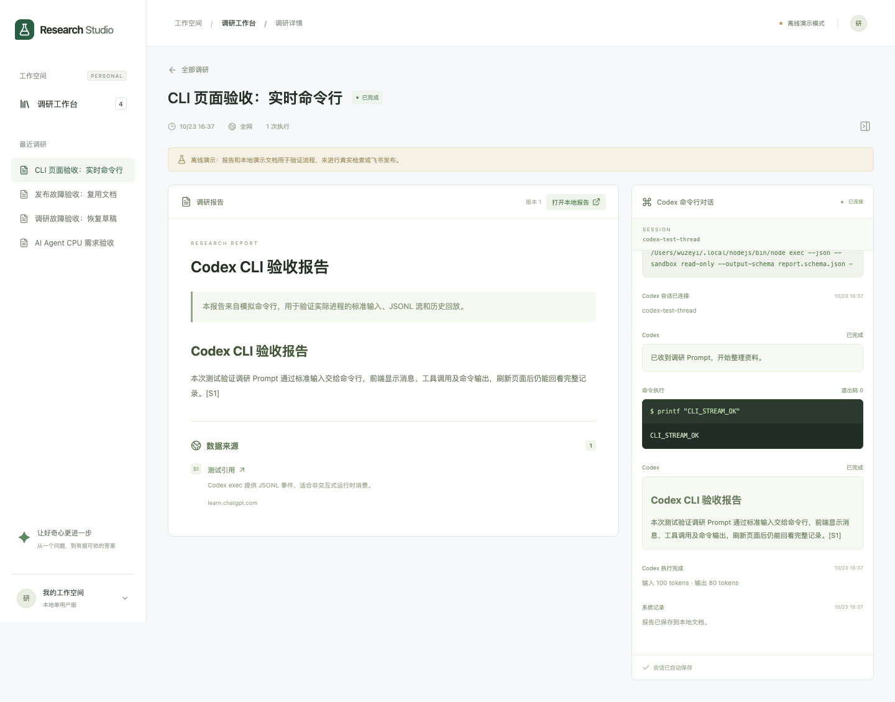
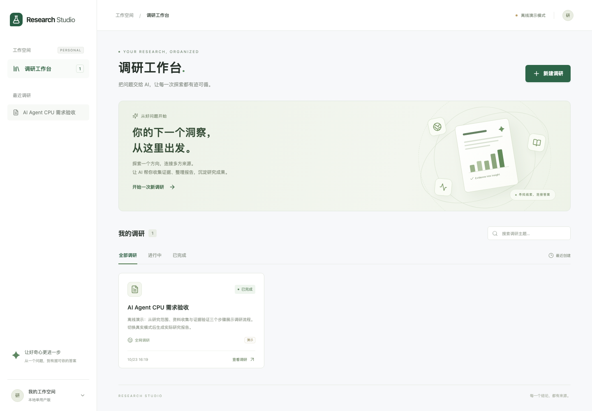
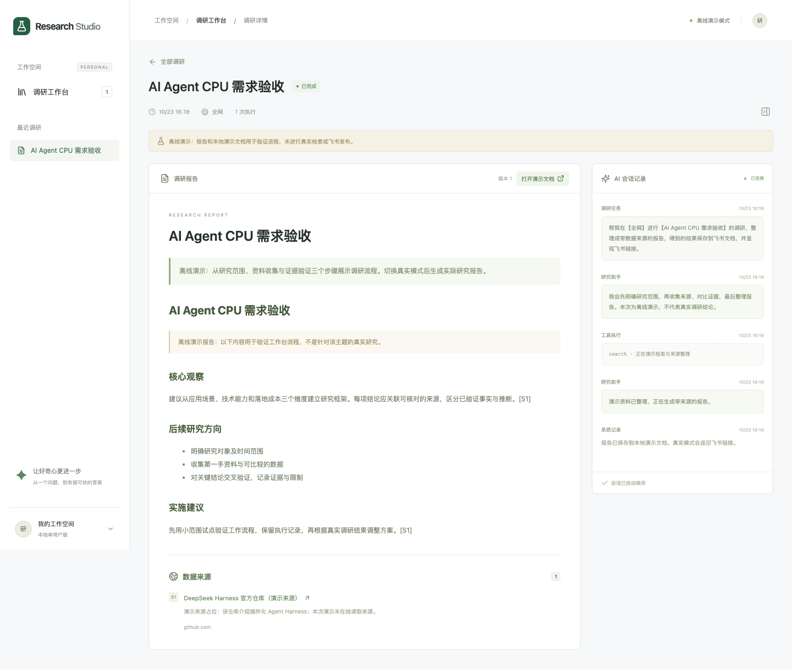

# 0.18.1 中文显示名

界面页签和主页显示「调研工作台」，项目和插件包名保留 dsh-research-workbench。113 项 Node、26 项浏览器、真实宿主及离线包验收通过。

# 0.18.0 名称统一

项目与插件名统一为 dsh-research-workbench。113 项 Node、26 项浏览器用例及新名称下的真实宿主验收通过；参见 [升级说明](rename-2026-11-02-dsh-research-workbench.md)。

# 0.17.1 工作台启动恢复

113 项 Node 回归，26 项浏览器交互，真实 DSH 宿主新增启动超时后重试恢复验证。详见 [修复说明](fix-2026-11-02-workbench-startup.md)。

# 0.17.0 / PRD 2036 验收

109 项 Node、26 项浏览器用例；覆盖扫码登录后选择/创建应用、同账号个人授权、取消过期、状态互斥及历史会话。官方真实二维码生成与隔离宿主验证通过。详见 [实现与验收](prd-2026-11-02-qr-application.md)。

# 0.16.1 换账号授权应用指引

103 项 Node、25 项浏览器用例；新增重新绑定方式选择和扫码无应用权限时更换应用回归。详见 [修复说明](fix-2026-11-02-feishu-app-visibility.md)。

# 0.16.0 / PRD 1990 验收

103 项 Node、24 项浏览器用例，覆盖自动二维码、所选应用显示、绑定应用一致性、无应用和失败重试。详见 [实现与验收](prd-2026-11-02-feishu-account-app.md)。历史记录如下。

# 0.15.0 / PRD 1956 验收

101 项 Node、22 项浏览器用例通过。覆盖自定义应用配置、独立授权与交付、凭据不回显、默认应用保留及失败任务恢复。详见 [实现与验收](prd-2026-11-01-own-feishu-app.md)。历史记录如下。

# 0.14.0 / PRD 1951 验收

96 项 Node、21 项浏览器用例通过。新增二维码重新绑定账号、新旧流程失效、取消保留原登录与历史数据回归。详见 [实现与验收](prd-2026-10-31-rebind.md)。历史记录如下。

# 0.13.1 / PRD 1939 验收

93 项 Node、20 项浏览器用例通过；新增根目录方式二选一、链接独立提交、Prompt 同步、移动端与历史快照回归。详见 [实现与验收](prd-2026-10-31-root-choice.md)。历史记录如下。

# 0.13.0 / PRD 1915 验收

92 项 Node、19 项 Chromium、真实隔离宿主与发布包检查通过；“微纳核芯”原会话已实际交付飞书并完成只读核验。新增文件夹链接与 ID 复用，不要求目录列表/搜索授权。详见 [实现与验收](prd-2026-10-31-folder-link.md)。历史记录如下。

# 0.12.1 飞书上传权限修复

修复“已绑定但目录读取/搜索权限不足”，新增旧权限误判与增量授权回归。详见 [修复说明](fix-2026-10-30-feishu-scopes.md)。

# 0.12.0 / PRD 1907 验收

85 项 Node、18 项 Chromium、真实 DSH 隔离宿主验证通过。新增飞书前置绑定、扫码确认、仅云端报告与无详情页。详见 [实现与验收](prd-2026-10-30-cloud-only.md)。历史记录如下。

# 0.11.0 / PRD 1742 验收

验证结果：80 项 Node、18 项 Chromium、真实 DSH 隔离宿主及发布包检查通过。两端插件已更新并加载 0.11.0。

最新范围：飞书根目录配置、原生调研自动保存、报告卡片直达飞书和独立 AI 会话。详见 [实现与验收](prd-2026-10-30-feishu-root.md)。历史记录如下。

> 当前版本 0.10.0 / PRD 修订 1572：[新调研标准模式](prd-2026-10-29-standard-mode.md)。以下包含历史规则与记录。

> 当前版本 0.9.1 / PRD 修订 1567：[统一风格与返回工作台](prd-2026-10-29-unified-return.md)。以下包含历史规则与记录。

> 当前版本 0.8.0 / PRD 修订 1511：[工作台内嵌原生会话](prd-2026-10-29-embedded-session.md)。以下包含历史规则与记录。

> 当前版本 0.7.0 / PRD 修订 1488：[宿主原生会话与自动验收更新](prd-2026-10-29-native-session.md)。以下包含旧规则与历史记录。

> 当前版本 0.6.0 / PRD 修订 1101：[默认模型实现与验收](prd-2026-10-28-native-model.md)。配置AI只选择Agent；dsh tui沿用DSH原生默认模型。以下包含历史规则与验收记录。

# 最新验收：PRD 修订 792 · 手动上传飞书

已执行 `npm run acceptance`：38 项后端/API/真实 PTY 测试、8 项 Chromium 验收全部通过，Vite 生产构建通过。

本轮覆盖：研究专用默认 Prompt、报告生成不自动上传、点击后只转交一次 Agent、旧 requestId 回执隔离、报告不变/执行次数不增、扫码后继续保存、失败单独重试、恢复历史 Session、无报告和忙碌状态拒绝上传、进程启动失败可见。

飞书调用由 PTY 测试进程模拟，二维码是 PNG 加载夹具；本次没有替用户实际扫码或创建飞书文档。实现及来源见 [PRD 修订 792](prd-2026-10-27-manual-upload.md)。以下为历史验收记录，上传流程以本节为准。

# 最新验收：2026-10-27 默认完整访问

36 项 Node 测试、7 项 Chromium 验收通过，生产构建通过。新建和恢复进程使用 danger-full-access/on-request；参数、持久化元数据、WebSocket 快照与前端显示一致。恢复历史会话不重发调研 Prompt，普通刷新不重启进程。

完整访问由启动参数控制，自动化验证使用真实 PTY 测试进程，不执行模型访问用户工作目录外文件的写入测试。本机 CLI 帮助确认支持所用参数。详见 [2026-10-27 更新](prd-2026-10-27.md)。

以下为历史验收记录，权限规则以本节为准。

# 最新验收：2026-10-26 PRD 更新

- Node 后端/API/PTY/兼容模块：34 项通过。
- Chromium：7 项通过。
- Vite 生产构建：通过。
- 生产链路已改为 Agent 负责飞书保存及授权；平台只读回执并展示。
- 已验证报告生成不提前打断保存、授权后继续同一会话、不重复调研、二维码及链接状态更新、旧平台上传接口禁用、保存中终端退出后显示失败并保留报告。
- 真实二维码扫码及远端文档正文未在本次自动化中验证；本次用交互测试进程模拟 Agent 和 PNG 加载。

规则来源及实现见 [PRD 更新](prd-2026-10-26.md)。以下为历史交付记录，其中平台 token / 上传方案已被本次更新取代。

# 首版验收结果

验收日期：2026-10-23（Asia/Shanghai）。

| 检查 | 结果 |
|---|---|
| Node 业务/API/发布器/协议/CLI/PTY 测试 | 34 / 34 通过 |
| Chromium 浏览器验收 | 7 / 7 通过 |
| 真实进程 SIGKILL → SQLite 恢复 → 重试 | 通过（AC-17） |
| 生产构建 | 通过，Vite 6.4.5 |
| npm audit | 0 个已知漏洞 |
| 390px 移动端布局 | 通过，无页面横向溢出 |
| Harness 模型真实检索 | 未执行：尚未配置并验证专用 SDK profile 与模型授权 |
| 飞书账号真实发布 | 未执行：尚未配置用户 token 与目标目录 |
| Harness 内原生 UI 插件安装 | 本版本未交付；当前为独立工作台与 SDK 协议适配器 |
| Codex CLI 真实执行 | 通过：已有 ChatGPT 登录，项目指定 gpt-5.6-sol，执行只读命令并检索官方资料，报告本地保存 |

已执行 `npm run acceptance`。覆盖原有工作台流程，以及 Codex 标准输入、实时事件、取消/超时、进程收尾、命令卡片合并与刷新回放；生产构建和全部 6 项浏览器验收通过。

协议与飞书测试使用模拟外部服务。它们验证本地恢复/重试逻辑与请求形状，不代表真实服务版本、权限、检索质量或飞书远端幂等行为已经验证。本机现有 `dsh --version` 返回 `0.1.5-rc.2`；开发参考官方仓库当前 SDK stdio 合约，需选定并验证实际部署版本。

复跑命令及全部用例见 [验收用例](acceptance.md)，外部服务配置见 [README](../README.md)。

## Codex CLI 接入验收

新增 5 项 CLI 后端用例和 1 项页面用例，累计 27 项自动验收通过。真实 CLI 会话 ID 为 `01a167e4-f309-7090-a581-b85a3444d73e`，工作台任务 ID 为 `4b75f8ba-9f81-4d10-bca5-69f08ba83aa7`。

真实执行确认：`printf CLI_LIVE_OK` 的退出码为 0，前端记录包含对应输出；官方页面读取后返回含一个来源的结构化报告，已保存至本地。原全局模型 gpt-6.1-sol 在该 CLI 账号下请求被拒绝，本项目 `.env` 指定 gpt-5.6-sol 后重试完成，保留了原失败记录。全局配置未修改。飞书仍未做真实账号验收。

## 页面截图

## 原生终端接入

新增 4 项真实 PTY 后端测试和 1 项页面测试，累计 32 项。已验证真实 Codex 原生会话恢复，页面 `/status` 命令返回原生状态界面，输入区可继续操作。调研模式从 JSONL 卡片切为原始 PTY 输出；原有 JSONL 用例继续通过。

详见 [原生终端说明](native-terminal.md)。

以下截图来自隔离的自动化验收环境，数据均为演示任务。

## 调研完成后保持终端待命

新增 AC-PTY-05、AC-PTY-06，并扩展 AC-PTY-02 / AC-UI-06；累计 28 项后端测试、6 项 Chromium 测试全部通过，生产构建通过。

- 验证有效报告交付后，正常完成通知使状态变为“等待新要求”，不发送多余中断。
- 验证报告生成后仍循环工作的进程会收到一次 Escape，停止本轮且 PTY 保持运行；刷新后继续输入可用，调研不重复创建。
- 验证新输入撤销收尾计时，终端设备响应不会误当用户输入，旧轮次通知不会覆盖较新请求。
- 已完成报告的真实 Codex Session `01a16807-1895-7e70-a02d-ca4e59121515` 恢复后未自动重跑。输入简短连接验收要求后正常回复，原生完成通知生效，页面回到“等待新要求”；原调研执行记录仍为 1 次。
- 优化长终端记录的批量回放，避免数千条碎片逐条渲染导致恢复状态长时间不可见。

真实环境的防重复工作软中断由真实 PTY 测试进程验证；真实 Codex 本次验证了会话恢复、继续对话和完成通知，没有重新执行完整调研。

## 飞书文档库上传

新增 4 项后端验收和 1 项页面验收，累计 32 项后端、7 项 Chromium 验收通过，生产构建通过。支持已有本地报告补传、文档库“我的空间”、断点续传、错误提示和本地副本保留。新报告默认要求上传飞书；缺少授权时保留报告并提示配置后重试。

验收使用模拟飞书 API。当前未配置 FEISHU_USER_ACCESS_TOKEN，真实报告尚未上传，仍需完成用户授权后联调。

## 2026-10-27 PRD 833

41 项 Node 测试、9 项 Chromium 验收通过。dsh 0.1.5-rc.2 实际安装插件并打开主面板，显示 13 条原有调研。详见 [插件验收](prd-2026-10-27-dsh-plugin.md)。

## 2026-10-27 PRD 859

42 项 Node 测试、9 项 Chromium 用例通过。0.3.0 发布包包含生产依赖，仓库外独立临时目录离线安装及 Node / 桌面版 Electron 双运行时原生 PTY 验收通过。详见 [发布验收](prd-2026-10-27-release.md)。

## 2026-10-27 PRD 884

0.3.1 已通过桌面版“添加插件”弹窗本地目录安装并启用；界面显示正确版本和调研工作台侧栏入口。42 项 Node 测试通过，ZIP/tgz 在仓库外普通 Node 和桌面 Electron 的页面、权限和 PTY 验收通过。详见 [桌面弹窗验收](prd-2026-10-27-desktop-dialog.md)。

## 2026-10-27 PRD 941

42 项 Node 测试、10 项浏览器用例通过。0.3.2 tgz/ZIP 独立安装与双运行时 PTY 验收通过。3088 已同步新前端，实际历史链接默认显示报告。详见 [历史页验收](prd-2026-10-27-history-report.md)。

## 2026-10-27 PRD 945 与二维码问题

50 项 Node 测试、12 项 Chromium 用例及本机双运行时发布包验收通过。Windows 真机 CI 已配置但尚未运行。实际二维码回执时区问题已定位并修复，新包为 0.4.0。详见 [Windows 与授权验收](prd-2026-10-27-windows-auth.md)。

## PRD 1070

53 项 Node 测试、13 项页面用例通过；真实 dsh tui 的独立本机模拟 Messages API 与原生 turn/end 验证通过。0.5.0 发布包双运行时验收通过。详见 [AI配置验收](prd-2026-10-27-ai-settings.md)。

## 0.5.1 DSH 凭据输入与恢复修复

57 项 Node 测试、14 项页面用例通过。新增密钥格式校验、旧密钥无效提示、原生 turn/end 错误回传和修正密钥后原会话重试。真实 dsh tui 对本机模拟 Messages API 的 401 验证通过，失败后保留终端连接。实际账户 API Key 仍需用户在配置AI中重新填写纯密钥，未验证该账户模型调用。
