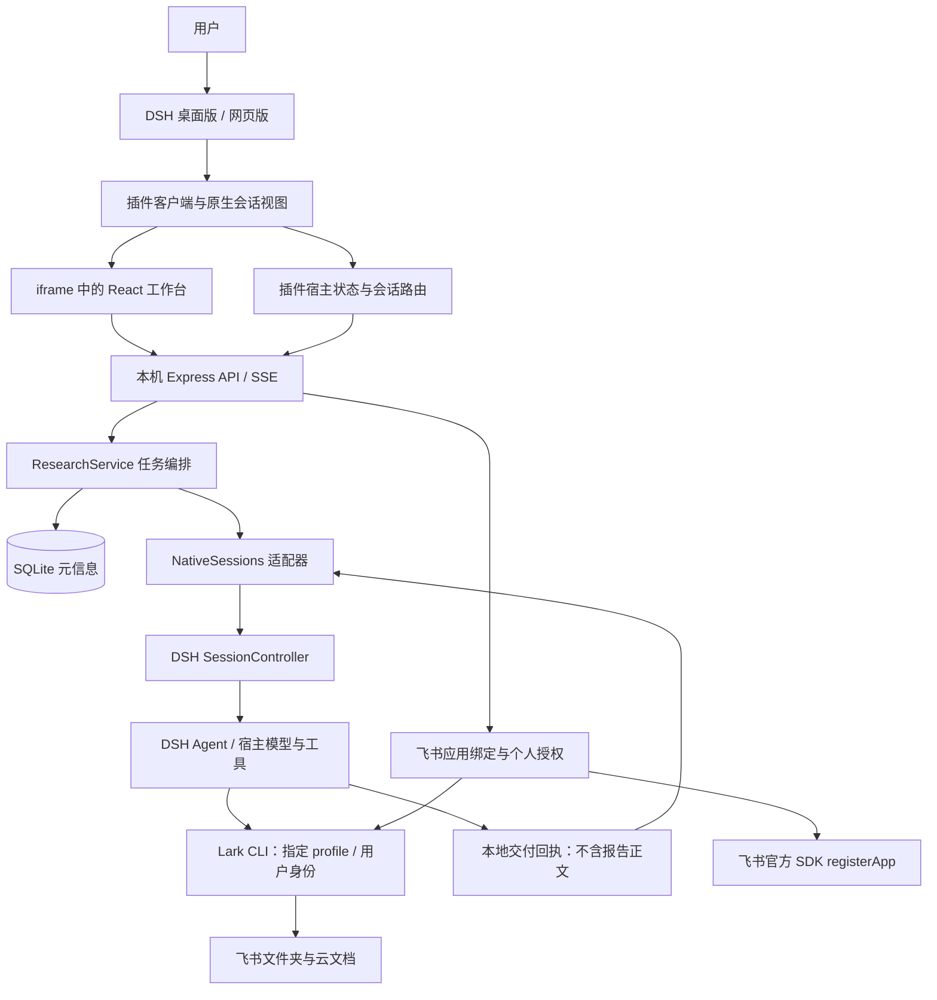
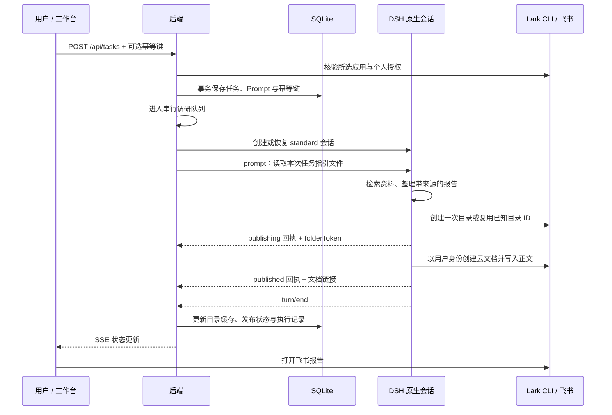

# dsh-research-workbench 技术架构

更新时间：2026-11-02。本文以当前源码为准，描述 DSH 插件的生产主链路；旧任务兼容层与离线演示另行标注。

## 1. 总体设计

系统是本地单用户 DSH 插件，兼容 DeepSeek Harness 桌面版和网页版。插件负责调研入口、任务编排、飞书绑定和交付状态；模型调用、工具执行、对话历史及原生聊天界面由 DSH 宿主管理。报告正文以飞书云文档为交付载体。



这不是独立托管的多用户 SaaS：没有远程账号系统、共享队列、独立模型网关或云端数据库，当前只监听本机地址。

## 2. 技术栈与职责

| 层级 | 技术 / 入口 | 职责 |
| --- | --- | --- |
| 宿主插件 | `plugin/index.mjs`、Cordis patch | 注入 webServer、sessionController、permissionPresets，管理后端生命周期 |
| 宿主客户端 | `plugin/client.js` | 侧栏入口、主面板、iframe 通信、原生会话挂载与释放 |
| 工作台界面 | React 19、Vite 6、`src/main.jsx` | 调研表单、历史卡片、绑定弹窗、目录设置、状态与错误展示 |
| HTTP 服务 | Node.js ≥22.13、Express 4、`server/app.mjs` | JSON API、静态资源、SSE、来源限制与输入校验 |
| 业务编排 | `server/service.mjs` | 幂等创建、单任务队列、取消、重试、恢复、交付状态转换 |
| 原生会话 | `server/native-sessions.mjs` | 创建或恢复 Session、发送指令、订阅轮次事件、读取回执 |
| 飞书接入 | 官方 Node SDK、Lark CLI | 扫码选择 / 创建应用、个人 OAuth、Agent 创建目录和文档 |
| 本地存储 | `node:sqlite`、SQLite WAL、`server/store.mjs` | 任务与执行记录、会话绑定、设置、事件和幂等键 |
| 校验 | Zod | 请求、目录链接、应用配置及交付回执结构校验 |
| 兼容层 | node-pty、WebSocket、xterm.js | 历史独立终端任务的输入输出与回放；不是新插件任务的对话主链路 |

## 3. 前端与 DSH 原生对话

工作台 React 应用通过 iframe 嵌入宿主，隔离宿主与插件的前端依赖。工作台经同源 `/api` 调用后端，任务变化通过 SSE 接收。

点击“AI会话”时，iframe 发出包含 taskId 和 requestId 的 postMessage。插件核对消息来源与 iframe 窗口，再经宿主 `/research-workbench/session` 查询该任务实际绑定的 Session ID。插件使用 `sessions.retain` 获取引用，挂载 `SessionProvider`，通过 `conversation.content` 插槽渲染 DSH 原生聊天组件。

因此，聊天消息、工具调用、模型设置与输入框直接来自宿主，不是把终端字符重新解析为聊天气泡。切换任务、返回工作台或卸载组件时释放界面引用；返回列表不会删除宿主会话。并发打开请求以修订计数和 requestId 防止过期响应覆盖新会话。

启动页轮询宿主状态，单次请求最长约 8 秒，整体启动等待约 20 秒；失败时显示错误与“重新连接工作台”。原生详情的任务状态另以约 2 秒间隔同步。

## 4. 后端启动与隔离

`plugin/index.mjs` 的 `apply` 调用 `connectRuntime`，在真实 DSH 宿主下选用 `native` 模式；`server/runtime.mjs` 组装 Store、ResearchService、NativeSessions、FeishuBinding 和 HTTP 服务。

- 后端监听 `127.0.0.1`；插件默认随机空闲端口。独立服务默认端口 3088，DSH 网页宿主端口由其启动参数决定，两者不是同一服务。
- 默认数据目录为 `DSH_HOME/research-workbench`，未设置 DSH_HOME 时为 `~/.dsh/research-workbench`；可通过插件 dataDir 覆盖。
- 数据目录中的 `.runtime.lock` 防止两个运行时同时占用同一个数据库；过期进程锁可清理。
- 指定固定端口时通过健康检查比对 application、数据目录指纹和 transport；拒绝复用其他数据库或错误模式的服务。
- 插件卸载时停止自身拥有的运行时；复用已有运行时时不取得其关闭所有权。

保留的 `research-workbench` 路由、存储目录和通信命名空间用于升级兼容，插件包名及注册 ID 为 `dsh-research-workbench`。

## 5. 一次调研的完整链路



任务新建与重试前都检查飞书授权。当前队列保存在内存中，同时仅运行一个工作台编排任务；幂等键与任务记录持久化。这个限制不等于禁止用户在宿主其他会话自行执行任务。

新会话使用 `standard` Agent 预设，并设置 `danger-full-access` 权限预设。模型与工具配置由 DSH 提供，工作台不单独配置新原生任务的模型密钥。任务指引写入 `sessions/<taskId>/prompt-<id>.txt`，再通过 `sessionController.prompt` 的 queue 模式发送读取指令。

Agent 固定使用任务快照指定的 Lark CLI profile 和用户身份，检索来源、创建文档、验证结果，并回写结构化交付元信息。成功交付且轮次结束后，任务进入 `ready / done`；会话保留供后续追问。

## 6. 飞书应用绑定、账号授权与目录

应用绑定和用户授权是两层状态：

1. `FeishuRegistration` 使用官方 SDK 的 `registerApp` 发起飞书官方页面，让用户选择可管理的已有应用或创建应用。
2. 工作台取得结果后，通过 CLI stdin 把 Secret 交给随机独立 profile；CLI 保存成功后才提交所选应用配置。
3. 界面继续个人 OAuth，`FeishuBinding` 经 CLI 启动 Device Flow、生成二维码、完成授权并核验状态。
4. 检查真实授权 scopes、所选 App ID 和扫码用户 openId 一致性，防止换账号后仍复用不匹配应用。报告仍以个人身份保存。

工作台 SQLite 保存 appId、profile 和账号约束元信息，不保存 App Secret 或 OAuth token。密钥与 token 由 Lark CLI 的本机凭据机制管理；其实际存储方式取决于 CLI 和操作系统配置，本文不把它描述为工作台自建的加密仓库。Device Flow 的临时状态保存在运行时内存，二维码使用临时目录并支持取消与过期清理。

当前代码要求的用户权限：

- `docx:document:create`、`docx:document:write_only`、`docx:document:readonly`
- `docs:document:import`、`drive:drive.metadata:readonly`
- `space:folder:create`、`offline_access`

不依赖云盘目录列表读取或文档搜索权限。用户提供文件夹链接时直接解析 token；未提供时首次创建根目录并缓存 token，后续复用。目录缓存按应用 profile 和根目录名称区分。创建结果不确定时要求核对或提供已知目录链接，避免盲目重复创建。

工作台负责绑定、状态与指令编排；实际文档创建和正文写入由 Agent 调用 CLI 完成。

## 7. 报告回执与前端呈现

平台获知“已保存飞书”的依据是 Agent 写入指定本地交付回执，不是从聊天文字中抓取链接，也不通过搜索云盘推断结果。

```json
{
  "requestId": "本次交付请求的 UUID",
  "status": "published",
  "folderToken": "实际目标目录 ID",
  "url": "https://example.feishu.cn/docx/真实文档标识"
}
```

`NativeSessions` 大约每 200 毫秒轮询回执，轮次结束事件也触发核对；等待交付逻辑约每 150 毫秒检查状态，默认超时 10 分钟。校验包括结构、文件大小、requestId、链接及目标目录一致性。旧请求或其他会话的结果不能覆盖当前任务。

后端转换为 publication 状态并写入 SQLite，经 SSE 通知界面。首页卡片打开飞书链接，“AI会话”打开已绑定的 DSH Session。

平台信任符合契约的 Agent 交付结果，当前没有独立调用飞书读取接口逐段复核正文；有效链接和 published 状态并不等于平台独立审计了远端文档内容。

## 8. 数据存储边界

| 位置 / 表 | 保存内容 |
| --- | --- |
| `tasks` | 方向、来源要求、用户 Prompt、状态、执行记录、应用快照、目录、文档链接 |
| `settings` | 目录设置与缓存、应用选择、profile 引用与账号约束 |
| `events` | 任务事件及状态，用于 SSE 历史回放 |
| `requests` | 幂等键、规范化输入、任务 ID |
| `terminals` | 原生 Session / 历史终端绑定与轮次、交付元信息 |
| `terminal_frames`、`demo_documents` | 历史终端或演示模式的兼容数据 |
| 任务工作目录 | Prompt、交付回执等控制文件；新云端流程不应写报告正文 |
| DSH 宿主 | 模型配置、原生对话、工具执行及宿主会话历史 |
| 飞书云文档 | 新调研报告正文与来源链接 |

“报告仅存飞书”是新任务的指令与业务路径约束，不代表 Agent 无法写本机文件的强隔离。宿主会话、工具输出或 CLI 自身日志的保留策略也不由本插件完全控制。旧数据库内已有正文不会在升级时自动删除；云端模式详情接口屏蔽历史报告正文，SSE 只发送状态与会话状态事件。

## 9. 接口清单

以下是当前代码中的接口；历史兼容接口仍存在，不能据此推断它们适用于新云端任务。

| 方法 | 路径 | 用途 |
| --- | --- | --- |
| GET | `/api/health`、`/api/config` | 健康检查、运行模式和功能能力 |
| GET / POST | `/api/tasks` | 分页列表、经授权校验的新建任务 |
| GET | `/api/tasks/:id` | 任务元信息与模式相关的历史事件 |
| POST | `/api/tasks/:id/retry`、`/cancel` | 重试、取消 |
| GET | `/api/tasks/:id/session` | 任务绑定的宿主会话 ID |
| GET | `/api/tasks/:id/events` | SSE，支持 Last-Event-ID 或 after 回放 |
| GET / PUT | `/api/feishu-settings` | 根目录设置 |
| GET / PUT | `/api/feishu-application` | 应用信息、手动配置入口 |
| GET / POST / DELETE | `/api/feishu-registration` | 应用扫码流程状态、发起、取消 |
| GET | `/api/feishu-registration/qr/:id` | 应用绑定二维码 |
| GET / POST | `/api/feishu-binding` | 个人授权状态与发起授权 |
| POST | `/api/feishu-binding/complete` | 完成个人授权并验证 |
| GET | `/api/feishu-binding/qr/:id` | 个人授权二维码 |
| GET / PUT | `/api/ai-settings` | 历史独立执行器配置；新原生会话沿用宿主配置 |
| POST | `/api/tasks/:id/publish`、`/terminal`、`/terminal/stop` | 历史任务上传与终端控制；部分操作在云端模式被拒绝 |
| GET | `/api/tasks/:id/agent-qr` | 历史 Agent 授权二维码 |
| GET | `/api/demo/documents/:id`、`/api/local/documents/:id` | 演示 / 历史文档；云端模式返回 410 |

DSH 宿主另注册 `/research-workbench/status`、`/research-workbench/session?taskId=…`、`/research-workbench/theme.css`。历史终端 WebSocket 由 `server/terminal.mjs` 注册，新原生聊天由宿主会话协议提供，不走该 PTY 通道。

## 10. 状态、恢复与安全边界

任务状态主要为 `queued → running → ready / failed / interrupted`，交付状态主要为 `pending → publishing → published / failed`；历史流程另保留待授权等状态。轮次活动与任务状态分开记录，轮次结束不销毁会话。

服务重启后，排队任务可重新进入队列；已执行中的任务标记 interrupted，提示先核对远端交付。用户重试时复用原会话，优先核对已有资料与文档；不会声称重启后同一个操作系统进程始终存活，也不保证对远端创建操作实现跨系统事务或严格 exactly-once。

HTTP 仅允许本机 Host，修改请求检查 Origin；请求正文限 32 KB，应用与目录输入使用 Zod 校验。iframe 消息检查 origin、source 与任务标识。二维码接口检查固定流程 ID、有效期、PNG 文件签名及大小，并禁用缓存。应用选择或保存期间存在互斥控制，执行中限制更换应用。

这些措施针对本机单用户使用，不等于公网身份认证、租户隔离或远程授权系统。当前没有开放隧道访问的部署配置。

## 11. 构建、发布与验收

仓库：[zaki-zeyi/dsh-research-workbench](https://github.com/zaki-zeyi/dsh-research-workbench)。

- `main`：开发源码、测试、文档与预构建 dist。
- `release`：GitHub 默认分支，存放自包含安装包、预构建资源与生产依赖。DSH 添加插件直接填写仓库链接，无需分支后缀。
- `npm run plugin:pack`：构建前端，生成 tgz、桌面 ZIP 和 SHA256；不包含本机业务数据或凭据。
- `npm run plugin:publish-git -- --output <新临时目录> --push`：将正式包发布到 release，普通追加提交，不覆盖开发历史。
- `npm run test:git-install -- --pnpm-cli <DSH内置pnpm.mjs>`：全新 store 测试仓库直链安装，不添加 allowBuilds。

验证分层包括 Node 业务/API/绑定与兼容层测试、Playwright 页面验收、隔离宿主集成、发布包离线依赖检查、Node/Electron 加载以及实际 Git 冷安装。模拟授权和模型测试不替代真实用户扫码、真实模型资料质量或飞书企业管理员审批。

扩展多用户或公网部署前，需要额外设计身份与会话隔离、每用户凭据、持久化任务队列、并发控制与远端交付对账，不能仅修改监听地址。
